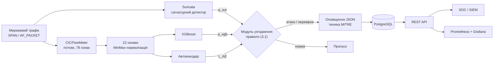

# Інтелектуальна система виявлення вторгнень у комп'ютерній мережі на основі машинного навчання

Програмний прототип до кваліфікаційної роботи: гібридна система виявлення вторгнень (IDS), у якій сигнатурний детектор **Suricata**, класифікатор мережевих потоків **XGBoost** і **автоенкодер** працюють паралельно, а окремий модуль узгодження приймає єдине рішення за формалізованим правилом.

## Зміст

1. [Анотація](#1-анотація)
2. [Мета та завдання дослідження](#2-мета-та-завдання-дослідження)
3. [Об'єкт та предмет дослідження](#3-обєкт-та-предмет-дослідження)
4. [Методи та інструменти](#4-методи-та-інструменти)
5. [Практична реалізація](#5-практична-реалізація)
6. [Структура репозиторію](#6-структура-репозиторію)
7. [Встановлення та запуск](#7-встановлення-та-запуск)
8. [Приклади використання](#8-приклади-використання)
9. [Результати експериментів](#9-результати-експериментів)
10. [Висновки](#10-висновки)
11. [Обмеження та напрями подальших досліджень](#11-обмеження-та-напрями-подальших-досліджень)
12. [Джерела даних та інструментів](#12-джерела-даних-та-інструментів)

## 1 Анотація

Сигнатурні засоби надійно розпізнають відомі атаки, але не реагують на нові; аномалійні методи помічають відхилення від нормальної поведінки, проте дають багато хибних спрацювань; класифікатори машинного навчання показують високі метрики на відкритих наборах даних, однак погано виявляють малочисельні категорії атак. У роботі ці три підходи поєднано в одній системі.

Потоки, агреговані CICFlowMeter, описуються 22 ознаками, відібраними із 78. Кожен потік оцінюють три детектори: Suricata формує бінарний сигнал $p_{sur}$, XGBoost - оцінку ймовірності атаки $p_{xgb}$, автоенкодер - похибку реконструкції $L_{AE}$. Модуль узгодження розв'язує суперечності між детекторами за правилом (3.1) з двома порогами оцінки XGBoost і двома порогами похибки автоенкодера. На відміну від простого об'єднання спрацювань, у зоні невизначеної оцінки класифікатора оповіщення формується лише за спільного підтвердження двох моделей.

За результатами, отриманими в роботі на наборі CICIDS2017, узгодження забезпечує macro-F1 0,982 за частоти хибних спрацювань 0,006 (окремий XGBoost - 0,974 і 0,014), а середній час прийняття рішення становить 0,46 мс на потік. Прототип має модульну архітектуру, REST API для інтеграції з центром моніторингу безпеки (SOC) і зіставляє оповіщення з техніками MITRE ATT&CK.

**Ключові слова:** система виявлення вторгнень, мережевий потік, машинне навчання, XGBoost, автоенкодер, Suricata, узгодження детекторів, дисбаланс класів.

## 2 Мета та завдання дослідження

**Мета роботи** - розроблення та експериментальне оцінювання інтелектуальної системи виявлення мережевих вторгнень, яка поєднує сигнатурні події, класифікацію потоків і оцінювання аномальності за узгодженим протоколом підготовки даних, для поліпшення виявлення малочисельних категорій атак за контрольованої кількості хибних оповіщень і прийнятної затримки.

**Завдання дослідження:**

1. Систематизувати загрози інформаційній безпеці комп'ютерних мереж і підходи до побудови систем виявлення вторгнень.
2. Визначити вимоги до системи та схему ознак мережевих потоків, доступних у момент прийняття рішення.
3. Підготувати незалежні навчальні, валідаційні й тестові частини даних без витоку інформації.
4. Навчити та зіставити базові й гібридні моделі машинного навчання.
5. Спроєктувати архітектуру гібридної системи та взаємодію її компонентів.
6. Реалізувати програмний прототип аналізу мережевого трафіку й формування оповіщень.
7. Оцінити якість виявлення, затримку та обмеження переносимості запропонованого рішення.

## 3 Об'єкт та предмет дослідження

**Об'єкт дослідження** - процес виявлення вторгнень у комп'ютерній мережі за мережевою телеметрією. Межами дослідження є спостережуваний мережевий трафік і відтворювані набори даних.

**Предмет дослідження** - методи формування потокових ознак, навчання моделей на незбалансованих даних та узгодження сигнатурного й аномалійного рішень.

**Робоча гіпотеза:** поєднання правила розв'язання суперечностей між детекторами, обмеженого класо-залежного балансування та відтворюваного відбору ознак дає вищий macro-F1 і нижчу частоту хибних спрацювань, ніж окремі детектори та їх просте об'єднання.

## 4 Методи та інструменти

### 4.1 Підходи до виявлення

Сигнатурний детектор спрацьовує, коли подія достатньо подібна до одного з $m$ відомих шаблонів, аномалійний - коли відстань від профілю нормальної поведінки $P$ перевищує поріг:

$$
d_{sig}(x) = 1 \iff \exists\ j \in \lbrace 1, \ldots, m \rbrace : \mathrm{sim}(x, s_j) \ge \theta \qquad (1.1)
$$

$$
d_{anom}(x) = 1 \iff \rho(x, P) \gt \delta \qquad (1.2)
$$

де $x$ - подія (потік), $s_j$ - сигнатура, $\theta$ - поріг подібності, $\rho$ - міра відхилення, $\delta$ - поріг аномальності.

### 4.2 Набори даних

Таблиця 1 - Набори даних, використані в роботі

| Набір даних | Записів | Вхідних ознак | Категорій атак | Призначення |
|---|---|---|---|---|
| CICIDS2017 | 2 830 743 | 78 | 13 (+ норма) | основний набір |
| NSL-KDD | 148 517 | 41 | 4 | порівняння з літературою |
| UNSW-NB15 | 257 673 | 49 | 9 | незалежна перевірка |

Набори даних до репозиторію не входять; їх потрібно завантажити з офіційних сторінок (розділ 12).

### 4.3 Підготовка даних без витоку інформації

Порядок кроків принциповий: очищення → поділ на частини → оцінювання параметрів перетворень лише на навчальній частині → балансування лише навчальної частини.

1. **Очищення:** видалення повних дублікатів, рядків із NaN/Inf, некоректних значень і надто малих класів. Викиди не видаляються, бо велике значення може бути ознакою атаки.
2. **Поділ 70/15/15:** хронологічний для CICIDS2017, груповий для NSL-KDD та UNSW-NB15.
3. **Нормалізація MinMax** з параметрами, оціненими тільки на навчальній частині:

$$
\tilde{x}_{i,j} = \frac{x_{i,j} - \min_{train}(x_j)}{\max_{train}(x_j) - \min_{train}(x_j)} \qquad (2.1)
$$

де $x_{i,j}$ - значення ознаки $j$ для потоку $i$.

4. **Обмежене класо-залежне балансування:** SMOTE застосовується лише до навчальних прикладів класів із часткою менше 1 % і доповнюється вагами класів; валідаційна й тестова частини зберігають природний розподіл.

### 4.4 Відбір ознак

Ознака залишається, якщо вона пройшла кореляційний фільтр Пірсона ($\lvert r \rvert \gt 0{,}95$) і входить до найкращих як за важливістю Random Forest, так і за взаємною інформацією:

$$
I(j) = \sum_{t \in T_j} \Big( p(t)\,\mathrm{Gini}(t) - p(t_L)\,\mathrm{Gini}(t_L) - p(t_R)\,\mathrm{Gini}(t_R) \Big), \qquad \mathrm{Gini}(t) = 1 - \sum_{c=1}^{C} p(c \mid t)^2 \qquad (2.2)
$$

$$
MI(X, Y) = \sum_{x} \sum_{y} p(x, y) \log_2 \frac{p(x, y)}{p(x)\,p(y)} \qquad (2.3)
$$

де $T_j$ - вузли дерев, що розщеплюють за ознакою $j$; $t_L$, $t_R$ - дочірні вузли; $p(c \mid t)$ - частка класу $c$ у вузлі $t$. У результаті простір ознак зменшено з 78 до 22 (на 71,8 %); відібрані ознаки становлять 89,1 % загальної інформативності та обчислюються сенсором у момент прийняття рішення. Перелік ознак наведено в [docs/methods.md](docs/methods.md).

### 4.5 Моделі

**XGBoost** - основний класифікатор (багатокласова постановка, 500 дерев глибиною до 8). Мінімізується регуляризована функція втрат:

$$
L(\varphi) = \sum_{i=1}^{n} l(\hat{y}_i, y_i) + \sum_{k=1}^{K} \Omega(f_k), \qquad \Omega(f) = \gamma T + \frac{\lambda}{2} \lVert w \rVert^2 \qquad (1.6)
$$

де $l$ - функція втрат, $f_k$ - дерево з $T$ листками та вагами $w$. Оцінка ймовірності атаки: $p_{xgb} = 1 - P(\mathrm{BENIGN} \mid x)$.

**Автоенкодер** - аномалійний компонент з архітектурою 22-128-64-16-[4]-16-64-128-22, навчений лише на нормальному трафіку. Мірою аномальності є похибка реконструкції:

$$
E(x) = \lVert x - g(f(x)) \rVert^2, \qquad L_{AE} = \frac{1}{n} \sum_{i=1}^{n} \lVert x_i - \hat{x}_i \rVert^2 \qquad (1.9),\ (2.4)
$$

де $f$ - енкодер, $g$ - декодер, $\hat{x}_i$ - реконструкція потоку $x_i$.

**Моделі порівняння:** Random Forest (базова), SVM, DNN, LSTM, Isolation Forest, One-Class SVM.

### 4.6 Метрики якості

Основна метрика - macro-F1 (середнє F1 за класами), оскільки нормальний трафік становить 80,3 % CICIDS2017, а найрідкісніший клас Heartbleed - 0,0004 %:

$$
F_1 = \frac{2 \cdot P \cdot R}{P + R}, \qquad P = \frac{TP}{TP + FP}, \qquad R = \frac{TP}{TP + FN} \qquad (1.10)
$$

Додатково оцінюються частота хибних спрацювань $FPR = FP / (FP + TN)$, ROC-AUC, час прийняття рішення на потік і кількість хибних оповіщень за годину.

### 4.7 Технологічний стек

Таблиця 2 - Технологічний стек прототипу

| Компонент | Технологія | Версія |
|---|---|---|
| Сигнатурний детектор | Suricata, правила ET Open | 7.0.6 |
| Витяг потокових ознак | CICFlowMeter | 0.6 |
| ML-класифікатор | XGBoost | 2.0.3 |
| Аномалійний детектор | TensorFlow / Keras | 2.15.0 |
| Балансування класів | imbalanced-learn (SMOTE) | 0.12.0 |
| Мова реалізації | Python | 3.11 |
| REST API | FastAPI | 0.109 |
| Сховище оповіщень | PostgreSQL | 16.1 |
| Зберігання журналів | Elasticsearch | 8.12 |
| Моніторинг | Prometheus + Grafana | 2.49 / 10.4 |
| Контейнеризація | Docker | 25.0 |

## 5 Практична реалізація

### 5.1 Архітектура



Рисунок 1 - Структурна схема гібридної системи

### 5.2 Правило узгодження

```math
R(x) = \begin{cases}
\text{«атака»}, & p_{sur} = 1 \\
\text{«атака»}, & p_{xgb} > p_1 \\
\text{«атака»}, & p_2 \le p_{xgb} \le p_1 \ \text{ та } \ L_{AE} > \tau_1 \\
\text{«норма»}, & p_{xgb} < p_2 \ \text{ та } \ L_{AE} < \tau_2 \\
\text{«перевірка»}, & \text{інакше}
\end{cases} \qquad (3.1)
```

де $R(x)$ - рішення для потоку $x$; $p_{sur} \in \lbrace 0, 1 \rbrace$ - вихід Suricata; $p_{xgb}$ - оцінка XGBoost; $L_{AE}$ - похибка реконструкції автоенкодера; $p_1$, $p_2$, $\tau_1$, $\tau_2$ - пороги.

Таблиця 3 - Порогові значення правила узгодження

| Параметр | Значення | Призначення |
|---|---|---|
| $p_1$ | 0,90 | верхній поріг XGBoost: впевнена атака |
| $p_2$ | 0,30 | нижній поріг XGBoost: відсіювання норми |
| $\tau_1$ | 0,025 | верхній поріг автоенкодера: впевнена аномалія |
| $\tau_2$ | 0,010 | нижній поріг автоенкодера: підтвердження норми |
| $\tau_{base}$ | 0,0148 | поріг автоенкодера як окремого детектора |

Таблиця 4 - Матриця рішень модуля узгодження

| Умова | Рішення | Тип оповіщення |
|---|---|---|
| $p_{sur} = 1$ | атака | сигнатурне (`signature`) |
| $p_{sur} = 0$, $p_{xgb} \gt p_1$ | атака | ML-впевнене (`ml_confident`) |
| $p_{sur} = 0$, $p_2 \le p_{xgb} \le p_1$, $L_{AE} \gt \tau_1$ | атака | узгоджене (`reconciled`) |
| $p_{sur} = 0$, $p_{xgb} \lt p_2$, $L_{AE} \lt \tau_2$ | норма | без оповіщення |
| $p_{sur} = 0$, $p_2 \le p_{xgb} \le p_1$, $L_{AE} \le \tau_1$ | перевірка | сумнівний потік → SOC (`review`) |
| $p_{sur} = 0$, $p_{xgb} \lt p_2$, $L_{AE} \ge \tau_2$ | перевірка | аномалія за низької оцінки → SOC (`review`) |

Сигнатурне спрацювання має пріоритет, тому жодна відома атака не втрачається. Перевірки виконуються від найдешевшої до найдорожчої: автоенкодер не викликається, якщо рішення вже визначено сигнатурою або впевненою оцінкою класифікатора. Складність алгоритму - $O(1)$ на потік. Реалізація: [src/hybrid_ids/reconciliation.py](src/hybrid_ids/reconciliation.py).

### 5.3 Модулі прототипу

Таблиця 5 - Модулі пакета `hybrid_ids`

| Модуль | Призначення |
|---|---|
| `capture` | запуск сенсорів Suricata та CICFlowMeter на інтерфейсі або PCAP-файлі |
| `feature_extraction` | зведення таблиці потоків до вектора з 22 ознак, контроль схеми |
| `data_preparation` | очищення, поділ без витоку, нормалізація (2.1), SMOTE і ваги класів |
| `feature_selection` | кореляційний фільтр, важливість Джині (2.2), взаємна інформація (2.3) |
| `suricata_runner` | розбір журналу EVE JSON, зіставлення подій із потоками, сигнал $p_{sur}$ |
| `xgboost_classifier` | класифікатор потоків, сигнал $p_{xgb}$ і категорія атаки |
| `autoencoder_detector` | автоенкодер, сигнал $L_{AE}$, калібрування $\tau_{base}$ |
| `reconciliation` | правило узгодження (3.1) |
| `alerting` | оповіщення, техніки MITRE ATT&CK, критичність, групування повторів |
| `storage` | таблиця `alert_records` (PostgreSQL або SQLite), вердикти аналітика |
| `api` | REST API для SOC |
| `metrics` | службова статистика та метрики Prometheus |
| `pipeline` | конвеєр `HybridIDS`: детектори → узгодження → оповіщення → сховище |
| `services` | сервіси висновування та ядро узгодження для контейнерного розгортання |
| `training`, `evaluation`, `baselines` | навчання, абляційні досліди, моделі порівняння |
| `synthetic` | генератор синтетичних потоків для демонстрації й тестів |
| `cli` | інтерфейс командного рядка |

### 5.4 REST API та оповіщення

| Метод | Шлях | Призначення |
|---|---|---|
| GET | `/alerts` | оповіщення за часовим діапазоном, класом атаки, рівнем достовірності |
| GET | `/health` | стан детекторів, час останнього висновування, розмір черги |
| GET | `/metrics` | метрики у форматі Prometheus |
| POST | `/verify/{flow_id}` | підтвердження або спростування оповіщення аналітиком |

Оповіщення зіставляються з техніками MITRE ATT&CK: сканування портів - T1046, перебір паролів - T1110, DoS - T1499, DDoS - T1498, SQL-ін'єкція - T1190, XSS - T1059.007, Heartbleed - T1040 і T1210, ботнет - T1071. Повторні оповіщення однієї атаки між тими самими вузлами в межах 5 хв групуються в один інцидент. Докладніше: [docs/api.md](docs/api.md), [docs/architecture.md](docs/architecture.md).

### 5.5 Розгортання

`docker-compose.yml` описує десять контейнерів: `suricata-sensor`, `cicflowmeter`, `xgboost-service`, `autoencoder-service`, `reconciliation-core`, `fastapi-gateway`, `ids-postgres`, `prometheus`, `grafana`, `elasticsearch`.

## 6 Структура репозиторію

```text
hybrid-ids/
├── README.md
├── pyproject.toml              # пакет hybrid_ids і залежності
├── requirements.txt            # зафіксовані версії для контейнера
├── Dockerfile
├── docker-compose.yml          # десять контейнерів розгортання
├── config/config.yaml          # пороги правила (3.1), сховище
├── deploy/                     # prometheus.yml, образ сенсора CICFlowMeter
├── docs/
│   ├── architecture.md         # архітектура, алгоритм, сховище, розгортання
│   ├── methods.md              # дані, ознаки, моделі, гіперпараметри
│   ├── results.md              # результати експериментів
│   └── api.md                  # REST API
├── src/hybrid_ids/             # програмна реалізація (таблиця 5)
└── tests/                      # автоматичні тести (pytest)
```

## 7 Встановлення та запуск

Потрібен Python 3.11 або новіший.

```bash
git clone <адреса цього репозиторію>
cd hybrid-ids
python -m venv .venv
source .venv/bin/activate            # Windows: .venv\Scripts\activate

pip install -e ".[full,dev]"         # повний стек: XGBoost, TensorFlow, FastAPI, PostgreSQL
# або мінімальний варіант без XGBoost і TensorFlow:
pip install -e ".[dev]"
```

Перевірка працездатності:

```bash
pytest                                        # автоматичні тести
python -m hybrid_ids demo --backend lite      # повний цикл на синтетичних потоках
```

Параметр `--backend` визначає реалізацію моделей: `full` - XGBoost і Keras (основна), `lite` - спрощені замінники scikit-learn для швидкої перевірки, `auto` - основна реалізація, якщо бібліотеки встановлено.

Контейнерне розгортання (попередньо навчіть моделі в каталог `models/`):

```bash
IDS_INTERFACE=eth1 docker compose up -d --build
```

## 8 Приклади використання

### 8.1 Відтворення експерименту на CICIDS2017

```bash
# 1. Очищення та хронологічний поділ 70/15/15
python -m hybrid_ids prepare data/raw/*.csv --out data/processed

# 2. Відбір ознак трьома методами
python -m hybrid_ids select-features --data data/processed

# 3. Навчання XGBoost та автоенкодера
python -m hybrid_ids train --data data/processed --models models --backend full

# 4. П'ять абляційних конфігурацій на тестовій частині
python -m hybrid_ids evaluate --data data/processed --models models --eve data/eve.json

# 5. Порівняння базової та контрольних моделей
python -m hybrid_ids compare --data data/processed --only rf,svm,iforest,ocsvm
```

Для хронологічного поділу та зіставлення з подіями Suricata потрібна версія CSV-файлів CICIDS2017 із колонками `Timestamp`, адрес і портів. Сигнал $p_{sur}$ отримують, відтворивши PCAP-файли набору через Suricata (`--eve`); без нього сигнатурна гілка вважається неактивною.

### 8.2 Обробка трафіку та REST API

```bash
# Обробка таблиці потоків CICFlowMeter разом із журналом Suricata
python -m hybrid_ids run --flows flows.csv --eve eve.json --models models --out alerts.jsonl

# REST API; інтерактивна документація: http://localhost:8080/docs
python -m hybrid_ids serve --port 8080

curl "http://localhost:8080/alerts?attack_class=DDoS&min_confidence=0.9"
curl http://localhost:8080/health
curl -X POST http://localhost:8080/verify/<flow_id> \
     -H "Content-Type: application/json" -d '{"confirmed": true}'
```

### 8.3 Правило узгодження з коду Python

```python
from hybrid_ids.reconciliation import reconcile

reconcile(p_sur=1, p_xgb=0.05, l_ae=None)     # attack, гілка signature
reconcile(p_sur=0, p_xgb=0.9963, l_ae=None)   # attack, гілка ml_confident
reconcile(p_sur=0, p_xgb=0.67, l_ae=0.0341)   # attack, гілка reconciled
reconcile(p_sur=0, p_xgb=0.67, l_ae=0.0200)   # review: сумнівний потік
reconcile(p_sur=0, p_xgb=0.10, l_ae=0.0050)   # normal: подвійне підтвердження
```

### 8.4 Приклад оповіщення

```json
{
  "flow_id": "0d4d0c63-649e-52f7-a171-78dea18a6575",
  "timestamp": "2026-03-02T09:37:25.405538+00:00",
  "src_ip": "192.168.56.105",
  "dst_ip": "192.168.56.20",
  "src_port": 40000,
  "dst_port": 80,
  "alert_type": "reconciled",
  "detector": "xgboost+autoencoder",
  "attack_class": "Web Attack - Sql Injection",
  "mitre_technique": "T1190",
  "p_xgb": 0.67,
  "l_ae": 0.0341,
  "severity": 3,
  "verified": false
}
```

### 8.5 Демонстраційний запуск

Команда `demo` генерує синтетичні потоки, імітує журнал Suricata, навчає моделі, виконує абляцію та обробляє тестову частину конвеєром. Фрагмент виводу:

```text
4. Обробка тестових потоків конвеєром: 1800 потоків, 474 оповіщень у 366 групах, ...
signature       246
ml_confident    115
review          113
```

Синтетичні дані лише показують працездатність конвеєра; значення метрик на них не є результатами роботи.

## 9 Результати експериментів

Наведені значення отримано в кваліфікаційній роботі на наборах CICIDS2017, NSL-KDD та UNSW-NB15. Повні таблиці: [docs/results.md](docs/results.md).

Таблиця 6 - Абляційні досліди на CICIDS2017 (норма проти атаки)

| Конфігурація | macro-F1 | F1 | Precision | Recall | FPR | ROC-AUC | Час, мс | Хибних/год |
|---|---|---|---|---|---|---|---|---|
| 1. Лише Suricata | 0,782 | 0,795 | 0,812 | 0,779 | 0,043 | 0,864 | 0,18 | 532 |
| 2. Лише XGBoost | 0,974 | 0,960 | 0,948 | 0,972 | 0,014 | 0,992 | 0,42 | 160 |
| 3. Лише автоенкодер | 0,738 | 0,842 | 0,798 | 0,891 | 0,085 | 0,918 | 0,31 | 1 551 |
| 4. Просте об'єднання (АБО) | 0,858 | 0,881 | 0,798 | 0,982 | 0,121 | 0,946 | 0,51 | 3 005 |
| **5. Узгодження (3.1)** | **0,982** | **0,978** | **0,985** | **0,971** | **0,006** | **0,994** | **0,46** | **68** |

Таблиця 7 - Гібридна система порівняно з окремим XGBoost

| Показник | XGBoost | Гібридна (3.1) | Зміна |
|---|---|---|---|
| macro-F1 | 0,974 | 0,982 | +0,008 |
| FPR | 0,014 | 0,006 | −57,1 % |
| Хибних оповіщень за годину | 160 | 68 | −57,5 % |
| Recall (Heartbleed) | 0,632 | 0,842 | +0,210 |
| Recall (SQL Injection) | 0,714 | 0,879 | +0,165 |
| Час прийняття рішення, мс | 0,42 | 0,46 | +0,04 |

Таблиця 8 - Гібридна архітектура на трьох наборах даних

| Набір даних | macro-F1 | F1 | FPR | ROC-AUC | Час, мс | Recall рідкісного класу |
|---|---|---|---|---|---|---|
| CICIDS2017 | 0,982 | 0,978 | 0,006 | 0,994 | 0,46 | 0,842 (Heartbleed) |
| NSL-KDD | 0,842 | 0,864 | 0,024 | 0,939 | 0,41 | 0,748 (U2R) |
| UNSW-NB15 | 0,861 | 0,879 | 0,029 | 0,948 | 0,43 | 0,762 (Worms) |

Під час перевірки на реальному трафіку в ізольованому сегменті виявлено всі три тестові атаки: SYN-сканування портів (сигнатурне оповіщення, 0,34 мс), DDoS SYN-flood (сигнатурне та ML-впевнене, 0,45 мс) і обфусковану SQL-ін'єкцію (узгоджене оповіщення, 88,5 % потоків, 0,68 мс).

## 10 Висновки

1. Систематизовано загрози інформаційній безпеці комп'ютерних мереж і підходи до побудови систем виявлення вторгнень; обґрунтовано вибір мережевого гібридного прототипу з пасивним оповіщенням, Suricata як джерела сигнатурних подій і CICFlowMeter як засобу обчислення потокових ознак.
2. Простір ознак зменшено з 78 до 22 поєднанням кореляційного фільтра, важливості за критерієм Джині та взаємної інформації; відібрані ознаки становлять 89,1 % загальної інформативності й обчислюються сенсором онлайн.
3. Сформовано незалежні навчальні, валідаційні й тестові частини трьох наборів даних; параметри нормалізації оцінено лише на навчальній частині, а класо-залежне балансування SMOTE застосовано лише до навчальних прикладів малочисельних класів.
4. Навчено та порівняно вісім моделей. У багатокласовій постановці XGBoost досяг macro-F1 0,931 проти 0,873 у Random Forest, 0,811 у DNN і 0,768 у LSTM; автоенкодер забезпечив ROC-AUC 0,918.
5. Спроєктовано гібридну архітектуру з модулем узгодження за правилом (3.1) і порогами $p_1 = 0{,}90$, $p_2 = 0{,}30$, $\tau_1 = 0{,}025$, $\tau_2 = 0{,}010$; складність алгоритму - $O(1)$ на потік.
6. Реалізовано програмний прототип із модульною архітектурою мовою Python: захоплення трафіку, витяг ознак, три детектори, модуль узгодження, JSON-оповіщення, сховище PostgreSQL, REST API та моніторинг Prometheus.
7. На CICIDS2017 узгодження забезпечило macro-F1 0,982, F1 0,978, FPR 0,006 і ROC-AUC 0,994. Порівняно з окремим XGBoost кількість хибних оповіщень зменшилася на 57,5 %, повнота класу Heartbleed зросла з 0,632 до 0,842, SQL Injection - з 0,714 до 0,879; просте об'єднання (АБО) дало лише macro-F1 0,858 за FPR 0,121. Робочу гіпотезу підтверджено.

## 11 Обмеження та напрями подальших досліджень

- Ефективність залежить від репрезентативності навчальних даних; результати на відкритих наборах не гарантують такої самої якості в іншій мережі.
- Автоенкодер чутливий до концептуального дрейфу трафіку та потребує періодичного перенавчання.
- Чотири пороги узгодження потрібно калібрувати для кожного мережевого середовища (`train --calibrate` дає лише початкове наближення).
- Аналіз спирається на метадані потоків і не розкриває вміст зашифрованих сеансів.

Перспективні напрями: урахування контекстної інформації, онлайн-навчання автоенкодера, графові нейронні мережі, пояснювальні методи SHAP і LIME, перевірка стійкості до змагальних атак.

## 12 Джерела даних та інструментів

- CICIDS2017, Canadian Institute for Cybersecurity: <https://www.unb.ca/cic/datasets/ids-2017.html>
- NSL-KDD, Canadian Institute for Cybersecurity: <https://www.unb.ca/cic/datasets/nsl.html>
- UNSW-NB15, UNSW Canberra: <https://research.unsw.edu.au/projects/unsw-nb15-dataset>
- Suricata: <https://suricata.io>
- XGBoost: <https://xgboost.readthedocs.io>
- MITRE ATT&CK: <https://attack.mitre.org>
- NIST SP 800-94, Guide to Intrusion Detection and Prevention Systems: <https://csrc.nist.gov/pubs/sp/800/94/final>
