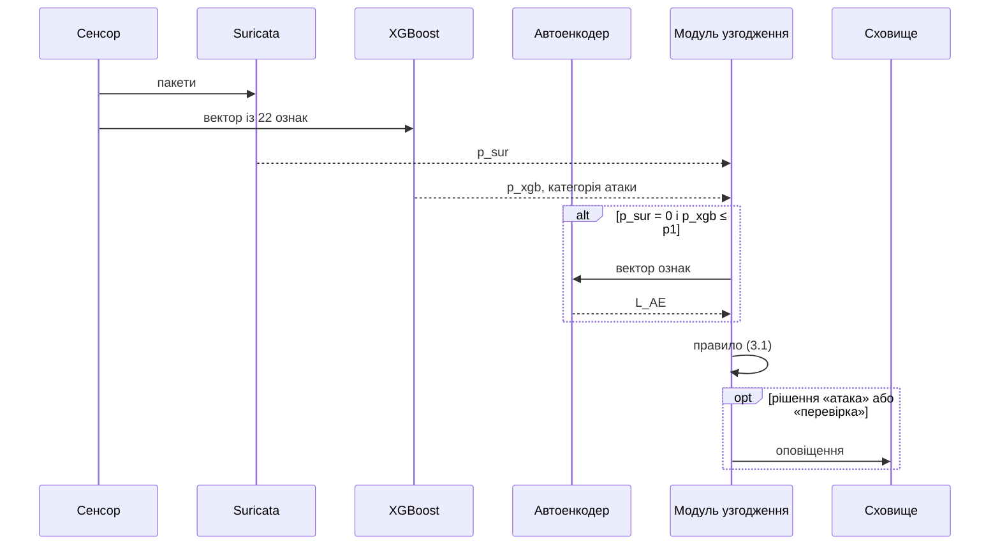

# Архітектура та алгоритм гібридної системи

Документ описує конструктивну частину роботи: компоненти системи, послідовність обробки потоку, алгоритм узгодження, структуру оповіщень і розгортання.

## 1 Компоненти

Таблиця 1 - Компоненти системи та їх реалізація

| Компонент | Вихід | Модуль | Контейнер |
|---|---|---|---|
| Сигнатурний детектор Suricata | $p_{sur} \in \lbrace 0, 1 \rbrace$ | `suricata_runner` | `suricata-sensor` |
| Сенсор потокових ознак CICFlowMeter | таблиця потоків | `capture`, `feature_extraction` | `cicflowmeter` |
| Класифікатор XGBoost | $p_{xgb} \in [0, 1]$, категорія атаки | `xgboost_classifier` | `xgboost-service` |
| Автоенкодер | $L_{AE} \ge 0$ | `autoencoder_detector` | `autoencoder-service` |
| Модуль узгодження | атака / норма / перевірка | `reconciliation`, `pipeline` | `reconciliation-core` |
| Підсистема оповіщень | запис `AlertRecord` | `alerting` | `reconciliation-core` |
| Сховище | таблиця `alert_records` | `storage` | `ids-postgres` |
| REST API | JSON, метрики | `api`, `metrics` | `fastapi-gateway` |

Обидва сенсори отримують ту саму копію трафіку (порт SPAN або той самий PCAP-файл). Події Suricata й потоки CICFlowMeter формуються різними інструментами, тому зводяться за адресами, портами, протоколом і часовим інтервалом життя потоку з допуском 5 с; ключ з'єднання двонапрямний.

## 2 Послідовність обробки потоку



Рисунок 1 - Взаємодія модулів під час обробки одного потоку

## 3 Алгоритм узгодження

```text
Вхід:  p_sur, p_xgb, L_AE; пороги p1, p2, tau1, tau2
Вихід: рішення R і гілка правила

1. Якщо p_sur = 1                    -> R = атака      (signature)
2. Якщо p_xgb > p1                   -> R = атака      (ml_confident)
3. Обчислити L_AE (виклик автоенкодера)
4. Якщо p_xgb < p2:
       якщо L_AE < tau2              -> R = норма      (double_confirmation)
       інакше                        -> R = перевірка  (anomaly_low_pxgb)
5. Інакше (p2 <= p_xgb <= p1):
       якщо L_AE > tau1              -> R = атака      (reconciled)
       інакше                        -> R = перевірка  (uncertain_low_lae)
```

Перевірки впорядковано за зростанням обчислювальних витрат. Автоенкодер викликається для всіх потоків, рішення щодо яких не визначено кроками 1-2: він потрібен як для підтвердження атаки в зоні невизначеності, так і для другого підтвердження норми. Частка таких викликів доступна в метриці `ids_autoencoder_share`.

Потоки з пропущеними, нечисловими або нескінченними ознаками не зараховуються до норми: вони обліковуються як технічні помилки (`ids_technical_errors_total`).

## 4 Оповіщення

Таблиця 2 - Відповідність гілок правила типам оповіщень

| Гілка правила | `alert_type` | `detector` | Клас атаки |
|---|---|---|---|
| сигнатура, $p_{xgb} \gt p_1$ | `signature` | `suricata+xgboost` | категорія XGBoost |
| сигнатура, $p_{xgb} \le p_1$ | `signature` | `suricata` | категорія XGBoost або клас за назвою сигнатури |
| $p_{xgb} \gt p_1$ | `ml_confident` | `xgboost` | категорія XGBoost |
| зона невизначеності, $L_{AE} \gt \tau_1$ | `reconciled` | `xgboost+autoencoder` | категорія XGBoost |
| решта | `review` | `xgboost+autoencoder` | `Anomaly` |

Таблиця 3 - Зіставлення класів атак із техніками MITRE ATT&CK

| Клас атаки | Техніка | Рівень критичності |
|---|---|---|
| PortScan | T1046 Network Service Discovery | 2 |
| FTP-Patator, SSH-Patator, Brute Force | T1110 Brute Force | 3 |
| DoS (Hulk, GoldenEye, Slowloris, Slowhttptest) | T1499 Endpoint Denial of Service | 4 |
| DDoS | T1498 Network Denial of Service | 4 |
| SQL Injection | T1190 Exploit Public-Facing Application | 3 |
| XSS | T1059.007 JavaScript | 3 |
| Heartbleed | T1040 Network Sniffing, T1210 Exploitation of Remote Services | 4 |
| Bot | T1071 Application Layer Protocol | 3 |

Ідентифікатор `flow_id` обчислюється детерміновано з ідентифікатора потоку CICFlowMeter і часу його початку, тому повторне повідомлення про той самий потік не створює нового інциденту. Оповіщення з однаковим класом атаки, джерелом і призначенням у межах 5 хв утворюють одну групу.

## 5 Сховище

Таблиця 4 - Структура таблиці `alert_records`

| Поле | Тип | Зміст |
|---|---|---|
| `id` | BIGSERIAL | первинний ключ |
| `flow_id` | UUID | ідентифікатор потоку |
| `timestamp` | TIMESTAMPTZ | час початку потоку |
| `src_ip`, `dst_ip` | INET | адреси |
| `src_port`, `dst_port` | INTEGER | порти |
| `alert_type` | TEXT | signature / ml_confident / reconciled / review |
| `detector` | TEXT | джерело доказу |
| `attack_class` | TEXT | клас атаки |
| `mitre_technique` | TEXT | техніка MITRE ATT&CK |
| `p_xgb` | REAL | оцінка XGBoost |
| `l_ae` | REAL | похибка реконструкції |
| `severity` | SMALLINT | рівень критичності 1-4 |
| `verified` | BOOLEAN | перевірено аналітиком |

Вердикти аналітика зберігаються в таблиці `alert_verdicts` і використовуються для оцінювання частки хибних оповіщень. У розгортанні застосовується PostgreSQL, для локального запуску й тестів - SQLite з тією самою схемою.

## 6 Розгортання

Таблиця 5 - Контейнери `docker-compose.yml`

| Контейнер | Образ | Призначення | Порт |
|---|---|---|---|
| `suricata-sensor` | Suricata 7.0.6 | сигнатурний аналіз, журнал EVE JSON | - |
| `cicflowmeter` | `deploy/flowmeter.Dockerfile` | агрегація пакетів у потоки | - |
| `xgboost-service` | образ застосунку | `POST /predict` → $p_{xgb}$ | 8001 |
| `autoencoder-service` | образ застосунку | `POST /score` → $L_{AE}$ | 8002 |
| `reconciliation-core` | образ застосунку | правило (3.1), оповіщення | - |
| `fastapi-gateway` | образ застосунку | REST API для SOC | 8080 |
| `ids-postgres` | PostgreSQL 16.1 | сховище оповіщень | 5432 |
| `prometheus` | Prometheus 2.49 | збирання метрик | 9090 |
| `grafana` | Grafana 10.4 | панелі моніторингу | 3000 |
| `elasticsearch` | Elasticsearch 8.12 | сирі журнали детекторів | - |

Сенсори працюють у мережі хоста й потребують прав на захоплення трафіку. Ядро узгодження звертається до сервісів висновування через HTTP; у локальному запуску (`python -m hybrid_ids run`) ті самі моделі викликаються в одному процесі.

Назви колонок CSV відрізняються між версіями CICFlowMeter. Модуль `feature_extraction` зводить поширені варіанти до єдиної схеми; перед запуском на новому сенсорі варто звірити заголовок його CSV-файлу.
